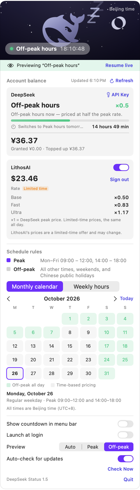
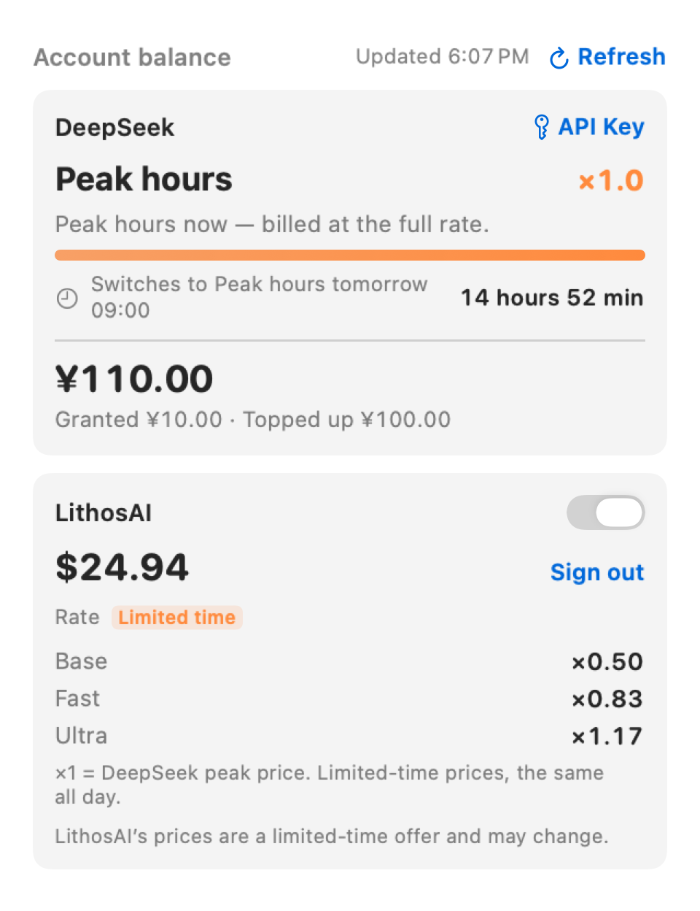
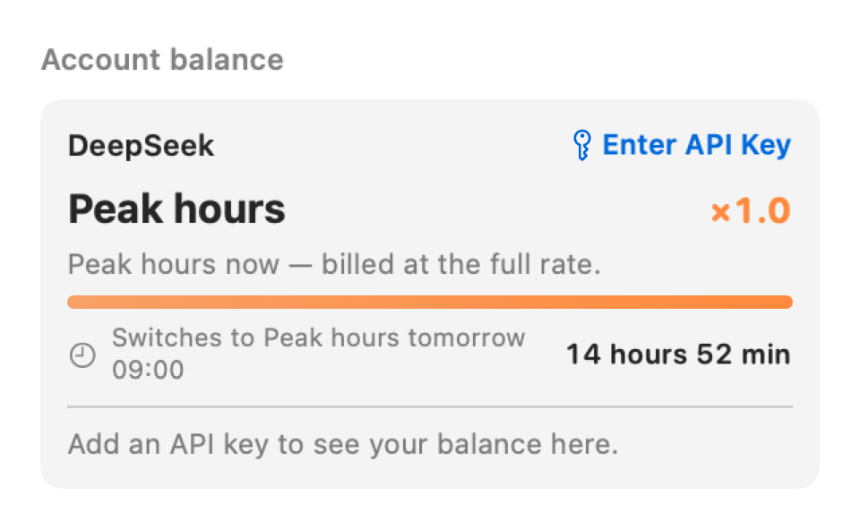
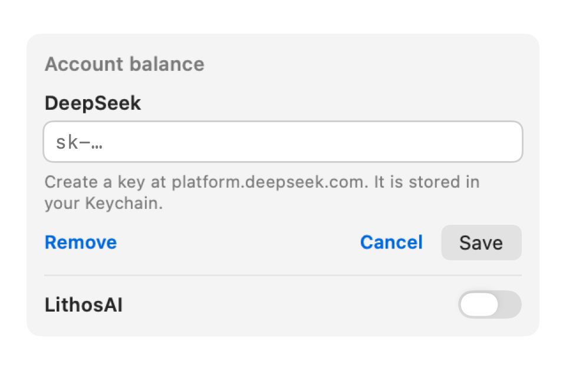
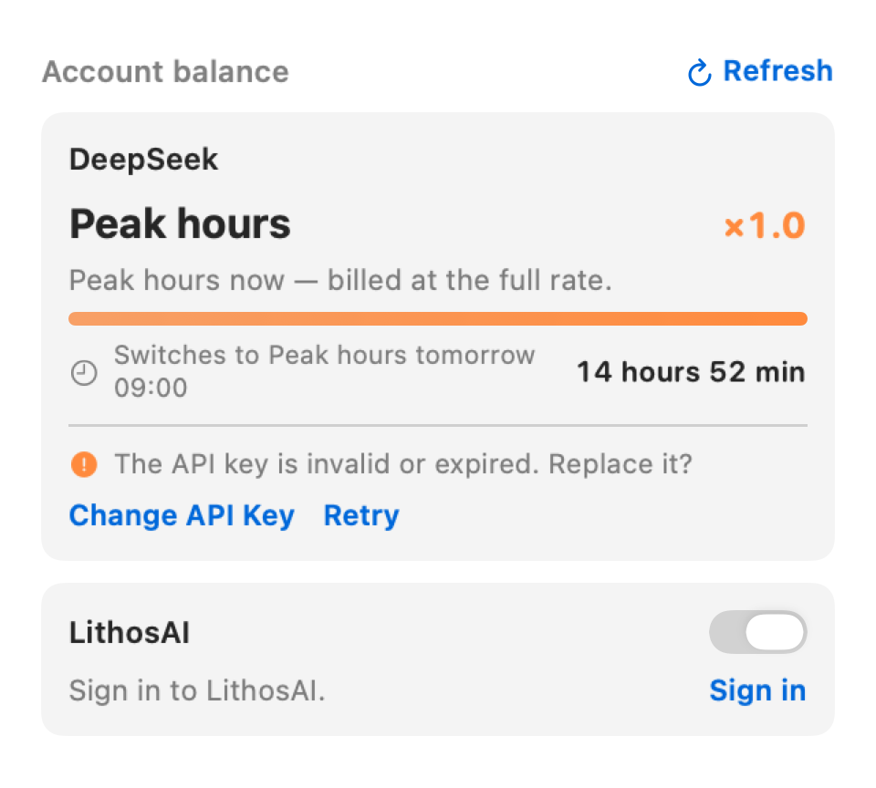
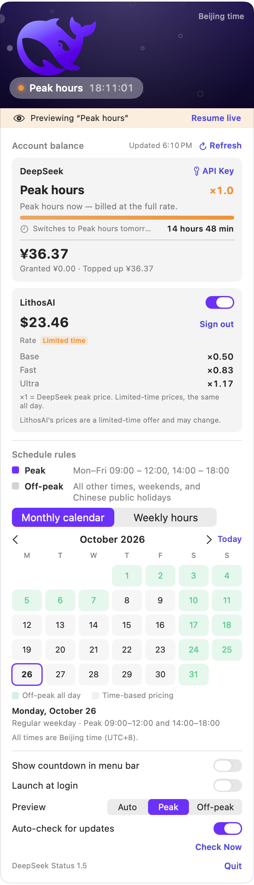
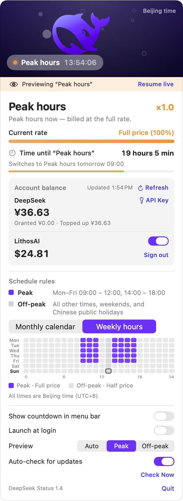

<div align="center">

# 🐳 DeepSeek Status

**A tiny macOS menu bar app that tells you — at a glance — whether DeepSeek is in peak or off-peak pricing, and how much is left in your API balance.**


[](https://github.com/owenzhao/DeepSeekStatus/releases/latest)
[](#requirements)
[](https://swift.org)
[](LICENSE)
[](#privacy)

</div>

Idle (off-peak) pricing is half the peak price, so "are we in peak hours right now?" is a question
worth answering without opening a browser tab. DeepSeek Status answers it with a whale.

- 🔵 **Peak hours** — a bright DeepSeek-blue whale, head up, bubbles trailing behind its tail.
- 😴 **Off-peak hours** — a pale, sleepy whale lying on its side, with little `z`s floating above it.

Click the whale to open a panel with one card per provider. The **DeepSeek** card holds the current
period, the price multiplier, a rate bar, a live countdown to the next switch and — once you paste an
API key — the balance left on your account. An optional **LithosAI** card adds your prepaid credits,
the three tier prices and its own sign-in. Below the cards sit a monthly pricing calendar and a weekly
schedule heat map. If you want, the countdown can also sit directly next to the menu bar icon.

---

## Screenshots

| Peak hours (`×1.0`) | Off-peak hours (`×0.5`) |
| :---: | :---: |
|  |  |
| *Current English build in peak preview mode.* | *Current English build in off-peak preview mode.* |

Each provider gets its own card — DeepSeek from the API key, LithosAI from its own sign-in — under one
shared **Refresh**:

| Both providers | Nothing yet, no requests |
| :---: | :---: |
|  |  |
| *The DeepSeek card holds the period and balance; the LithosAI card holds its credits and tiers, where `×1` is DeepSeek's peak price.* | *No key saved means the app never asks for a balance.* |

The key editor and a failed refresh, straight in the DeepSeek card:

| Key editor | Refresh failed |
| :---: | :---: |
|  |  |
| *Enter, change or remove the key in place; it lives in the macOS Keychain.* | *An expired key offers **Change API Key** right where it failed.* |

The schedule views:

| Monthly calendar | Weekly hours |
| :---: | :---: |
|  |  |
| *Public holidays and all-day off-peak dates at a glance.* | *The familiar 7×24 peak and off-peak grid.* |

Menu bar in both states and on different menu bar backgrounds:

| | Peak | Off-peak |
| :--- | :---: | :---: |
| **Dark menu bar** |  |  |
| **Translucent / light menu bar** |  |  |

---

## Pricing rule

> Off-peak pricing is half of peak pricing.
> Peak hours are **Monday–Friday 09:00–12:00 and 14:00–18:00, Beijing time**. Everything else is off-peak.

| Time (Beijing) | Period | Price |
| --- | --- | --- |
| Mon–Fri 09:00–12:00 | Peak | 100% |
| Mon–Fri 12:00–14:00 | Off-peak | 50% |
| Mon–Fri 14:00–18:00 | Peak | 100% |
| Mon–Fri 18:00–09:00 (next day) | Off-peak | 50% |
| Saturday and Sunday, all day | Off-peak | 50% |
| Chinese public holidays, all day | Off-peak | 50% |

Details:

- Ranges are **half-open**: 12:00 sharp is already off-peak, 18:00 sharp is already off-peak,
  and 09:00 sharp is already peak.
- The decision is **always made in Beijing time** (`Asia/Shanghai`, UTC+8, no daylight saving),
  regardless of your Mac's time zone. If your Mac is in a different time zone, the panel says so.
- Weekend make-up workdays remain off-peak all day. Weekdays included in the official Chinese
  holiday schedule are also off-peak all day.

---

## Requirements

- macOS **14.0 (Sonoma)** or later.
- Apple Silicon or Intel. The app is developed and tested on Apple Silicon (arm64); there is no
  architecture-specific code.

---

## Installation

### Build from source

Requires **Xcode 16 or later** — the project uses the file-system-synchronized group format
(`objectVersion = 77`). The Command Line Tools alone are enough for `Tools/build.sh`.
Developed with Xcode 27; the deployment target is macOS 14.0.

```bash
git clone <this repository>
cd DeepSeekStatus

./Tools/build.sh run     # build (Debug) and launch
```

Other options:

```bash
./Tools/build.sh          # Debug build only
./Tools/build.sh release  # Release build
```

The product lands in `Build/DerivedData/Build/Products/<configuration>/DeepSeekStatus.app`.

Or just open `DeepSeekStatus.xcodeproj` in Xcode, select the `DeepSeekStatus` scheme and press ⌘R.

### Prebuilt app

1. Grab the newest `DeepSeekStatus-<version>.zip` from the
   **[Releases page](https://github.com/owenzhao/DeepSeekStatus/releases/latest)**.
   The binary is universal — Apple Silicon and Intel — and needs macOS 14.0 or later.
2. Unzip it and drag `DeepSeekStatus.app` into `/Applications`.
3. The app is signed with a **Developer ID and notarized by Apple**, so it launches without a
   Gatekeeper prompt — no quarantine workaround needed.

Either way the app has **no Dock icon** — look for the whale in the menu bar, right of the
menu bar extras.

---

## Usage

| Action | What happens |
| --- | --- |
| **Left-click** the whale | Open / close the details panel |
| **Right-click** the whale | Quick menu: preview peak, preview off-peak, follow live time, show countdown in the menu bar, quit |
| **Account balance** | The DeepSeek card appears in the panel once an API key is saved. **Refresh** queries every enabled provider immediately; the time of the last successful refresh sits next to the button |
| **LithosAI card** | Off by default. Once it has a session, the card shows the prepaid balance, **Sign out** and its three tier prices. Turning the switch off only hides the card — the WebKit session is kept, so turning it back on does not ask you to sign in again. **Sign out** clears this app’s WebView website data, including OAuth sign-in cookies |
| **Enter / Change API Key** | Opens the key field in the panel. The key is stored in the macOS Keychain; **Remove** deletes it |
| **Preview** picker in the panel | Force the app to *display* peak or off-peak so you can see both looks at any time. It only changes what is drawn, never the real pricing |
| **Show countdown in the menu bar** | Adds an `HH:MM:SS` countdown next to the whale (off by default) |
| **Launch at login** | Registers the app as a login item via `SMAppService` (off by default) |
| **Auto-check for updates** | Sparkle checks the appcast in the background (on by default). **Check Now** in the panel, or **Check for Updates…** in the right-click menu, runs a check immediately |
| **Quit** | Quits the app |

The panel contains one card per provider, so everything about a provider sits in its own card:

- **DeepSeek** — the current period and its price multiplier (`×1.0` / `×0.5`), a "current unit
  price" comparison bar, the countdown to the next switch plus how far through the current block you
  are, and then the balance once an API key is saved (total, plus the granted / topped-up split);
- **LithosAI** — an on/off switch, the prepaid balance with **Sign out**, and its three tier prices
  (Base / Fast / Ultra) as a limited-time offer. Turn the switch off and the whole card disappears;
- one shared **Refresh** button and the time of the last successful refresh, above the cards;
- a monthly pricing calendar for planning ahead, switchable to a 7×24 weekly heat map;
- the toggles above, a preview picker, and the update controls.

The panel closes when you click anywhere outside it, press <kbd>Esc</kbd>, or click the whale again.

---

## Privacy

The pricing panel needs no account or API key. The app talks to the network in four narrowly scoped places:

- **Balance** (opt-in) — if you save a DeepSeek API key, the app calls
  `GET https://api.deepseek.com/user/balance` on launch, every 5 minutes, and when the panel opens or
  the Mac wakes with stale data. Your key is sent only in the `Authorization` header of that one
  request. **With no key saved, no request is ever made.**
- **LithosAI balance** (off by default) — when enabled, sign-in happens in the app's WKWebView.
  Once the console session exists, the sign-in window closes. The app reads its own WebKit session
  cookies in memory and sends them only to `console.lithosai.cloud` for read-only `GET /api/me`
  and `GET /api/billing`. It refreshes every 5 minutes while enabled. Cookie values are never
  logged or saved separately, and requests never follow redirects to another domain.
- **Updates** — Sparkle reads the appcast from this repository's latest GitHub release (daily by
  default, switchable off in the panel).
- **Holiday calendar** — at most once per day, the app anonymously checks Apple’s public China
  holiday calendar. It sends no API key, device-calendar data or other user information, and uses
  bundled/cached data while offline.

There is **no analytics and no telemetry**. The API key lives in your **macOS Keychain** — the entry
is encrypted by the system and readable after first unlock — never in a plain-text preferences file,
and **Remove** in the panel deletes it. It is deliberately *not* wrapped in a second layer of
home-made encryption: the key to that would have to sit in the same Keychain anyway, which buys
nothing. The app also stores the normalized holiday cache and the optional login item registration.

---

## FAQ

**Does it call the DeepSeek API or need an API key?**
Only if you want the balance. Pricing works with no key: it reads the local clock and the public
holiday schedule. If you paste a key into the panel, the app stores it in the Keychain and
calls `GET /user/balance` to show what is left. That is the only DeepSeek endpoint it ever calls, and
the balance is **account-wide**: every key of an account returns the same numbers.

**Where is the API key stored, and how do I delete it?**
In the macOS Keychain, as a generic password scoped to this app
(`com.parussoft.DeepSeekStatus.deepseek`). It is never written to `UserDefaults` or any plain file, and
it is not encrypted a second time by the app itself — see [Privacy](#privacy) for why. **Remove** in
the panel's key editor deletes it.

**My key expired. Can I still replace it?**
Yes, and that case is handled explicitly: a failed refresh always offers **Change API Key**, and an
expired key is reported as *"The API key is invalid or expired. Replace it?"*. A working key can be
replaced too, from the small key button next to the refresh time.

**What do the LithosAI prices mean?**
Every multiple in the app uses **DeepSeek's peak price as `×1`**, so the two providers can be compared
directly. DeepSeek's own row follows the clock (peak `×1`, off-peak `×0.5`); LithosAI does not have
peak hours, so its three tiers are the same all day: Base `×0.50`, Fast `×0.83`, Ultra `×1.17`. Those
are its current **limited-time** prices, read from a constant in the app rather than from the network,
and they may change — the number to trust is always the one in your LithosAI console.

**Does turning the LithosAI switch off sign me out?**
No. The switch only decides whether the card is shown; the WebKit session and its cookies stay, so
turning it back on resumes right where you left off. Only **Sign out** clears the website data.

**Which time zone is used?**
Beijing time (`Asia/Shanghai`, UTC+8, no DST) always, no matter where your Mac is. This is
deliberate: the pricing schedule is defined in Beijing time.

**Are Chinese public holidays handled?**
Yes. DeepSeek Status downloads Apple’s public China holiday calendar directly, without reading or
modifying your Calendar app and without requesting calendar permission. Weekday holidays and
weekend make-up workdays are shown in the monthly pricing calendar.

**Why is the menu bar whale not animated?**
On purpose. `NSStatusItem` continuously re-snapshots any custom view placed in it, which costs
20–30% CPU even with no animation at all. A static bitmap drawn once into `button.image` keeps idle
CPU at ~0%. The aquarium in the panel *is* animated, but it only runs while the panel is open.
See [Docs/DEVELOPMENT.md](Docs/DEVELOPMENT.md) for the measurements.

**Why does the whale change color between dark and light menu bars?**
The menu bar is translucent, so its backdrop depends on the wallpaper. A single color cannot have
enough contrast on both, so the app picks the palette per appearance: light blue on a dark menu bar,
brand blue on a light one.

**Which languages does the UI support?**
English (the default) and Simplified Chinese. The interface follows the language chosen for the app in
**System Settings → General → Language & Region → Applications**; the pricing schedule itself is always
computed in Beijing time. All UI strings live in a single String Catalog
(`DeepSeekStatus/Localizable.xcstrings`), so adding another language is just another column there.

**How do updates work?**
The app ships [Sparkle 2](https://sparkle-project.org) and reads the appcast at
`releases/latest/download/appcast.xml`. Downloads are signed with an EdDSA key and verified before
anything is installed, and every update is opt-in. Background checks are on by default (one per day)
and can be turned off in the panel. Maintainers publish with `./Tools/release.sh --upload`.

**Does the countdown update while the Mac is asleep?**
The app recomputes on wake, on system clock changes, and at midnight, so it is correct as soon as
the machine is back.

---

## How it works

- The whale is DeepSeek's own logo, embedded as a **vector path** — there are no image assets.
  A small SVG path parser (`M/L/H/V/C/S/Q/T/A/Z`, including elliptical arcs converted to cubic
  Béziers) parses it at runtime, so it stays sharp at any size and can be recolored freely.
- The menu bar icon is rasterized **once** into a 46×22 `NSImage` and handed to
  `NSStatusItem.button.image`.
- The panel is a self-positioned `NSPanel` (not `NSPopover`), so it can never be pushed off-screen.
- The schedule is computed from a fixed `Asia/Shanghai` calendar with half-open intervals and the
  cached Chinese public-holiday schedule; the app refreshes on clock changes, day changes and wake.
- The DeepSeek balance is one `GET /user/balance` call carrying the key from the Keychain. Responses carry a
  token, so a reply that arrives after you have already saved a different key is discarded instead of
  overwriting the new key's state.
- The LithosAI balance never touches the keychain: sign-in runs in the app's own `WKWebView`, and the
  resulting session cookies stay in that WebKit store, so the card can be turned off — or signed out —
  without affecting anything else on the Mac.
- Everything a provider knows lives in that provider's card: DeepSeek's period, rate bar and countdown
  used to sit in the panel header with its balance half a screen below, and LithosAI's tiers had
  nowhere to go. One card per provider means neither provider's rules can leak into the other's.
- The prices themselves are a small table (`Models/ProviderRateSheet.swift`) keyed to DeepSeek's peak
  price; DeepSeek's rows are `timeOfDay`, LithosAI's are `flat`, and a check in
  `./Tools/render-preview.sh rates` fails if the current period is ever multiplied into a fixed tier.

Architecture, tooling, measurements and the pitfalls found along the way are documented in
**[Docs/DEVELOPMENT.md](Docs/DEVELOPMENT.md)**.

---

## License

[MIT](LICENSE) © 2026 Zhao Xin

The whale is the official DeepSeek mark, taken from the [Simple Icons](https://simpleicons.org)
collection (CC0). "DeepSeek" and its logo belong to their owner. This project is an unofficial
utility and is not affiliated with or endorsed by DeepSeek.
